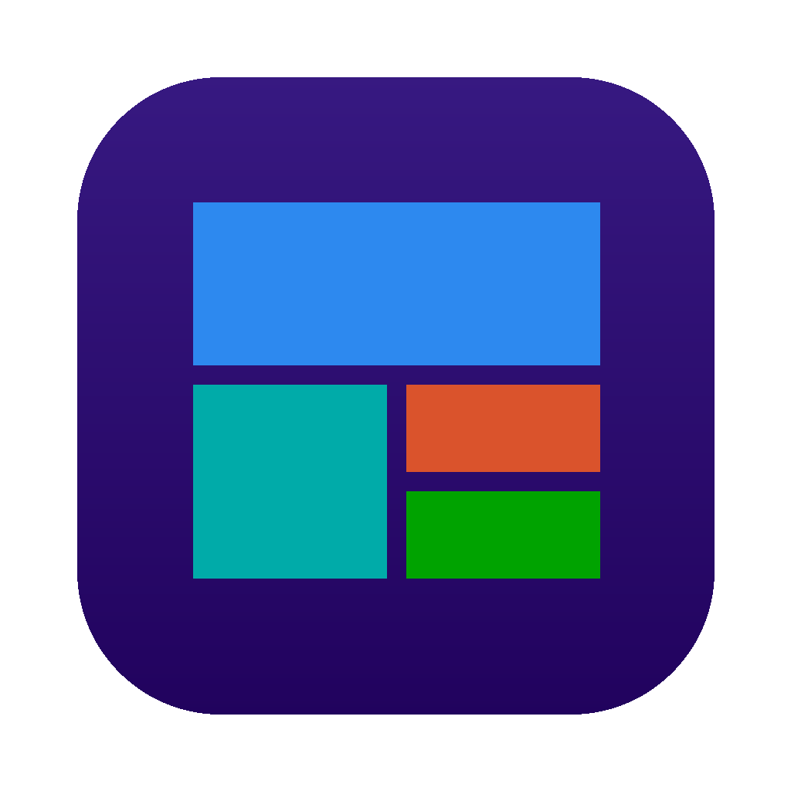

<p align="center"></p>

# MacTiles

**A lightweight, open-source app launcher for Apple silicon Macs that brings back the Windows 8 Start screen** — flat colored tiles, named groups, smooth tile cascades, and **Live Tiles** that flip to show the time, weather, your next meeting, headlines, photos and system stats.

Like Windows 8, Start is always there: launch an app and Start slips behind it, staying on your desktop so it's what you see whenever your windows are closed or minimized. Press **⌥ Space** or click the Dock icon to bring it back to the front.

Native Swift + SwiftUI. No Electron, no web views, no telemetry, no accounts. Live tiles pause whenever Start is covered, so it costs next to nothing in the background.

> MacTiles is an independent project and is not affiliated with or endorsed by Microsoft. Windows is a trademark of the Microsoft group of companies.

## Features

**The Start screen**
- Start lives on your desktop behind your apps, Windows 8 style, and its tiles stay clickable there
- Bring Start to the front with **⌥ Space** (configurable), the Dock icon (your "Start button"), the menu-bar icon, or the bottom-left hot corner
- Starts automatically at login once installed
- Tiles in four sizes — small, medium, wide, large — packed into groups exactly like Windows 8.1
- Drag tiles to reorder (neighbours slide out of the way as you drag), drop past the last group to start a new one
- Drag a group by its name to move it left or right; double-click the name to rename it
- Right-click a tile to resize, recolor, move to another group, show in Finder or unpin
- Drag any `.app` from Finder onto Start to pin it
- Tiles fly in with the staggered Windows 8 cascade and "tilt" when pressed (respects *Reduce motion*)
- A plain mouse wheel scrolls Start sideways, as it did on Windows 8

**Apps & search**
- **All apps** view (the ↓ arrow, bottom-left): every installed app, A–Z, grouped by letter. Apps you install, update or delete show up (or disappear) within a few seconds — no relaunch needed
- **Just start typing** to search — there's no search box. Whenever MacTiles has focus, keystrokes become a search and the results replace the tiles. Matches prefixes, words, substrings and initials (`vsc` → Visual Studio Code). Return opens the top hit, Delete erases (⌥ a word, ⌘ everything), Esc clears / closes

**Live Tiles**

| Tile | Shows | Source |
|---|---|---|
| Clock | Digital time & date, flips to an analog face | Local |
| Calendar | Today's date; optionally your next events | EventKit (opt-in) |
| Weather | Current conditions, high/low, 3-day forecast, for a city or a ZIP / postal code | [Open-Meteo](https://open-meteo.com) (free, no key) |
| System | CPU % with sparkline, memory use | Mac host statistics |
| Battery | Charge, charging state, time remaining | IOKit |
| Photos | Slideshow from a folder (default `~/Pictures`) | Local files |
| News | Rotating headlines from any RSS/Atom feed. Add several, each with its own source (right-click → *Change Feed…*) | Your chosen feeds |
| Desktop | Your current wallpaper; click to hide Start and use Finder's desktop | Local |

Live tiles only poll while Start can be seen — not when it's hidden or covered by your windows. Weather refreshes at most every 15 minutes and news every 30.

**Service tiles (homelab integrations)**

The same kinds of widgets [Homarr](https://homarr.dev) offers, as Metro tiles on Start. MacTiles talks to each service's own API directly; you don't need Homarr.

| Service | Tile shows | You can |
|---|---|---|
| Plex, Jellyfin, Emby | Now playing (who, what, progress) or recently added, with posters | Open the web app |
| Sonarr, Radarr | Upcoming episodes / releases, queue and missing counts | |
| Overseerr / Jellyseerr | Pending requests and the latest requests, with posters | |
| Pi-hole (v6 and v5), AdGuard Home | Queries, % blocked, clients, blocklist size | Pause blocking (1 min → until resumed), resume |
| Home Assistant | Any entity: lights, switches, sensors, climate, locks, covers, media players, scripts, scenes, automations | Click to toggle or run (locks only from the menu) |
| UniFi Network | Clients (Wi-Fi / wired), devices, latency, speed, WAN IP, gateway load | |
| OPNsense | Live traffic per interface (WAN speed with a sparkline), gateways (latency, packet loss), firewall states, memory, load, uptime, version | |
| Proxmox VE | Guests running, CPU, memory, storage, nodes, uptime | |
| TrueNAS | Pool health and usage, load, uptime | |
| Unraid | Array state and usage, CPU, memory, containers | |
| Glances | CPU, memory, disks, load, uptime | |
| Docker | Containers, running first (Docker Desktop, OrbStack, Colima or Rancher Desktop on this Mac, or a remote Docker API) | Start, stop, restart |
| Beszel | Every system's CPU / memory / disk and how many are up — or one system in full (CPU, memory, disk, GPU, temperature, network, load, uptime) | |
| ComfyUI | Live job progress (step by step), the queue, VRAM and RAM use, your latest images; GPU load, GPU temperature and CPU with the Crystools node | Interrupt the current job, clear the queue |

Connect a service in **Settings → Integrations → Add Service…** (there's a Test Connection button), then right-click an empty spot on Start → **Add Service Tile…**. Each tile picks a service, what to show, and a name; right-click it to refresh, pause, toggle or edit. Clicking a tile opens the service's web page.

- Passwords, tokens and API keys are stored in your **Keychain**, never in `layout.json`. (If you build MacTiles yourself with ad-hoc signing, macOS may ask once after each rebuild whether MacTiles can read them.)
- Self-signed certificates — the norm for Proxmox, UniFi, OPNsense and TrueNAS — are accepted only for services where you turn on *Allow self-signed certificate*, and only from that service's own server (not from sites it links to or redirects to).
- Keys and tokens are never forwarded when a service redirects to a different server. The editor warns you if an address is plain HTTP and not on your local network, since the key would travel unencrypted.
- macOS will ask once for **Local Network** access the first time MacTiles talks to a service on your network.
- Service tiles poll only while Start is on screen, at a pace suited to each widget (now playing every 15 s, stats every 20 s, upcoming every 5 min).

## Requirements

- A Mac with Apple silicon (M1 or later)
- macOS 14 Sonoma or later
- To build: Xcode 15.3+ or the Xcode Command Line Tools with Swift 5.10+

## Install

1. Download **MacTiles-x.y.z.pkg** from the [latest release](../../releases/latest).
2. Open it and follow the installer. MacTiles is installed in Applications, opens right away, and from then on opens each time you log in.

Prefer dragging? Download the **.dmg** instead, open it and drag MacTiles onto Applications.

Installing over an older version keeps your tiles and settings. To remove MacTiles, open **Settings → Uninstall MacTiles…**.

If a release isn't signed and notarized by Apple, macOS will refuse to open it the first time. Go to **System Settings → Privacy & Security**, scroll down and click **Open Anyway** (once).

### Build it yourself

Clone this repository (or download it with **Code → Download ZIP**), then in its folder:

```sh
make release        # tests, then build/release/MacTiles-<version>.pkg and .dmg
```

Without Apple signing credentials, the installer you build works on your own Mac. To make one other people can install, sign and notarize it: see [RELEASING.md](RELEASING.md).

Other targets: `make test`, `make app`, `make run`, `make install` (build and copy straight to Applications), `make clean`.

Builds are compiled and signed in `~/Library/Caches/MacTiles-build`, so keeping the project in iCloud Drive or a synced Documents folder doesn't break code signing.

## Using MacTiles

### How Start behaves

| State | What you see | How you get there |
|---|---|---|
| **Front** | Start covers the screen, ready to type | ⌥ Space, Dock icon, menu-bar icon, hot corner |
| **On the desktop** | Start sits behind all your windows; tiles still work | Launch an app, press Esc, or click another app |
| **Desktop** | Start is hidden; Finder's desktop and icons are back | The Desktop tile, or Dock / menu-bar → Show Desktop |

Prefer the old behavior where Start disappears completely after you launch something? Turn off **Settings → Behavior → Keep Start on the desktop**. You can also hide the Dock icon there.

### Everyday actions

| Action | How |
|---|---|
| Launch an app | Click its tile, or just start typing its name and press Return |
| All apps | ↓ arrow at bottom-left; ↑ to go back |
| Pin an app | Right-click it in All apps → Pin to Start, or drag it from Finder |
| Add a live tile | ⋯ menu (top-right), menu-bar icon, or Dock icon menu |
| Settings | Right-click an empty spot → MacTiles Settings…, ⋯ → Settings…, or ⌘, |
| Tile shape | Settings → Tile shape: Square, Soft or Round |
| Add a web tile | Right-click an empty spot → Add Web Tile…, or drag a link from your browser onto Start |
| Add a service tile | Settings → Integrations → Add Service…, then right-click an empty spot → Add Service Tile… |
| Running apps | Tiles of running apps show a small dot (Settings → Start screen to turn off) |
| Tile look | Settings → Tile finish (Flat or Glass), Glass tint, and Tile shadow (None → Strong) |
| Wallpaper | Settings → Background: Color, Picture or Video (incl. animated GIFs and looping videos), or Live |
| Background color | Settings → pick a preset, or use the color wheel / a hex code for any color |

**Weather** needs a city: Settings → Live tiles → type a city → Find.
**Calendar events** are opt-in: Settings → *Show upcoming events on the Calendar tile* (macOS will ask for permission).
**Hot corner as a toggle**: Settings → Opening Start → *Corner also closes Start and shows the desktop when Start is open* makes the bottom-left corner open Start, and close it to the desktop when it's already open.
**Hot corner** uses a global mouse-move monitor; if it doesn't fire, allow MacTiles under System Settings → Privacy & Security → Accessibility.
**⌃ Space** is macOS's input-source shortcut by default — pick another shortcut if you use multiple keyboard layouts.

## Your layout

Everything is stored in one readable JSON file:

```
~/Library/Application Support/MacTiles/layout.json
```

You can hand-edit it, back it up, or sync it. Missing keys fall back to defaults, out-of-range values are clamped to what Settings allows, and if the file can't be read MacTiles saves a copy beside it before restoring the default layout. Settings → *Show Layout File* reveals it in Finder. The file is readable by your account only (it lists your services' addresses and user names; their passwords and keys are in the Keychain).

**Uninstall** (Settings → *Uninstall MacTiles…*) removes the login item and moves the app to the Trash; tick *Also delete my tiles, settings and saved service keys* to remove `~/Library/Application Support/MacTiles` and MacTiles' Keychain items too.

## Project layout

```
Sources/MacTiles/
  App.swift              entry point, menu-bar item, Edit menu
  Launcher.swift         Start window: front / on-the-desktop / hidden, hot key, hot corner
  Installer.swift        move-to-Applications, login item, uninstall
  LayoutStore.swift      tiles, groups, settings, JSON persistence, drag & drop logic
  Models.swift           Tile, TileGroup, TileSize, TileKind, AppSettings
  AppCatalog.swift       installed-app scanning, icons, search ranking
  TypeToSearch.swift     turns keystrokes into the search query (no search box)
  Focus.swift            hands keyboard focus to the apps MacTiles opens (macOS 14 cooperative activation)
  RunningApps.swift      tracks running apps for the tile dot
  WebTiles.swift         web tiles: addresses, site icons and titles, add/edit panel
  Integrations/          service tiles: Integration + Keychain secrets, HTTP / Unix-socket client,
                         each service's API and parsers (Services.swift), ServiceHub polling
  Wallpaper.swift        color, picture/GIF/video and live backgrounds
  DesktopPicture.swift   finds the real desktop wallpaper for the Desktop tile (built-in, dynamic, aerial, shuffle)
  FolderWatcher.swift    FSEvents watcher that rescans when /Applications changes
  HotKey.swift           Carbon global hot key (no Accessibility permission needed)
  Theme.swift            Metro palette, color helpers, icon tinting
  Live/DataSources.swift Open-Meteo, RSS/Atom, Mach stats, IOKit battery, ImageIO thumbnails
  Live/Providers.swift   observable providers; polling only while Start is visible
  Views/                 Start screen, tile packing, live tiles, service tiles, All apps, search,
                         Settings (incl. Integrations)
Scripts/build-app.sh     builds and signs MacTiles.app (version stamping, hardened runtime)
Scripts/paths.sh         build locations (outside the project, safe for iCloud folders)
Scripts/privacy-check.sh looks for personal data and secrets before you push (also runs in CI)
Scripts/release.sh       installer package + disk image, signed, notarized and stapled
Resources/Installer/     installer pages, Distribution.xml, pre/postinstall scripts
Tests/MacTilesTests/     unit tests (`make test`)
```

How tiles are packed: each group is a run of columns four small-tile units wide. Tiles fill a column top-to-bottom, left-to-right, back-filling gaps with small tiles, and spill into the next column when full — the same flow as the Windows 8.1 Start screen. See `Packer` in `Views/StartTiles.swift`.

## Contributing

Issues and pull requests are welcome — see [CONTRIBUTING.md](CONTRIBUTING.md). Found a security problem? Please report it privately as described in [SECURITY.md](SECURITY.md). Good first contributions:

- New live tiles (stocks, Now Playing, Reminders, mail count) — add a `TileKind`, a provider in `Live/Providers.swift`, and a view in `Views/LiveTiles.swift`
- Keyboard navigation between tiles (arrow keys)
- A shortcut recorder to replace the preset list
- Localization

Please keep it light: no heavyweight dependencies, and no polling while Start can't be seen.

## Releases

See [CHANGELOG.md](CHANGELOG.md) for what changed, and [RELEASING.md](RELEASING.md) for how releases are built, signed and published.

## Privacy and third-party services

MacTiles has no telemetry, analytics, accounts or servers of its own. It only connects to:

| Service | When | What it receives |
|---|---|---|
| [Open-Meteo](https://open-meteo.com) | Weather tile, and Settings → Find / Use | The city or ZIP / postal code you look up, then its coordinates. Weather data by [Open-Meteo.com](https://open-meteo.com/), [CC BY 4.0](https://creativecommons.org/licenses/by/4.0/); the free API is for non-commercial use. |
| Your news feeds (default: BBC News world headlines) | News tiles | A normal request for each feed (or, when you enter a site's address, its page, to find the feed) |
| Websites you pin as web tiles | When the tile is added or its icon refreshed | A request for the page and its icon |
| Google's favicon service | Only if a site's own icon can't be found | That site's domain name |
| Services you connect (Plex, Pi-hole, Home Assistant…) | While service tiles are on screen | Requests signed with the key or password you entered |

Everything else — your layout, settings, wallpaper copies and site icons — stays in `~/Library/Application Support/MacTiles`, and service secrets stay in your Keychain.

Plex, Jellyfin, Emby, Sonarr, Radarr, Overseerr, Pi-hole, AdGuard Home, Home Assistant, UniFi, OPNsense, Proxmox, TrueNAS, Unraid, Glances, Docker, Beszel and ComfyUI are trademarks of their respective owners. MacTiles talks to their public APIs and isn't affiliated with or endorsed by any of them.

## License

MIT — see [LICENSE](LICENSE). MacTiles has no third-party code dependencies; it uses only Apple's system frameworks. The app icon is original artwork, released under the same license.
